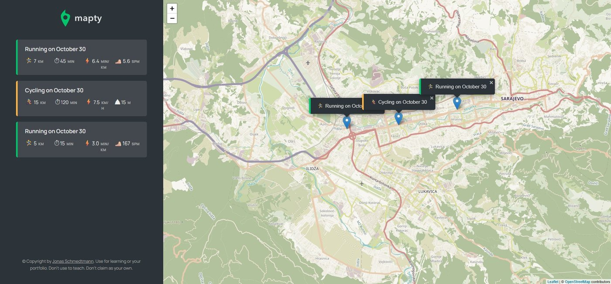

# Mapty

A workout log on a map: click the map, add a run or a cycling ride, and it is saved.

> Built while following a JavaScript course, so it shows what I learned rather than an original design.

## Features

- Uses the browser's geolocation to centre a [Leaflet](https://leafletjs.com/) map; clicking the map opens a form for a new workout
- Object-oriented code with ES classes: `Workout`, extended by `Running` and `Cycling`, plus an `App` class for the interface
- Workouts are stored in `localStorage` and restored when the page is reopened
- Clicking a workout in the list moves the map to it

## Run

Open `final/index.html` in a browser and allow location access. An internet connection is needed for the map tiles.

## Author

Harun Kestendžić — [GitHub](https://github.com/harunkestendzic)
